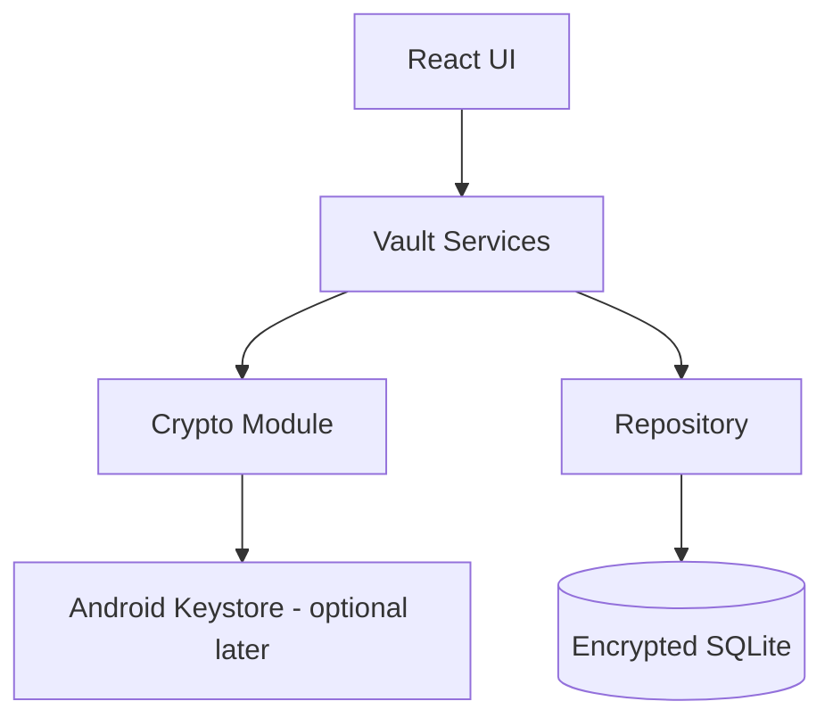
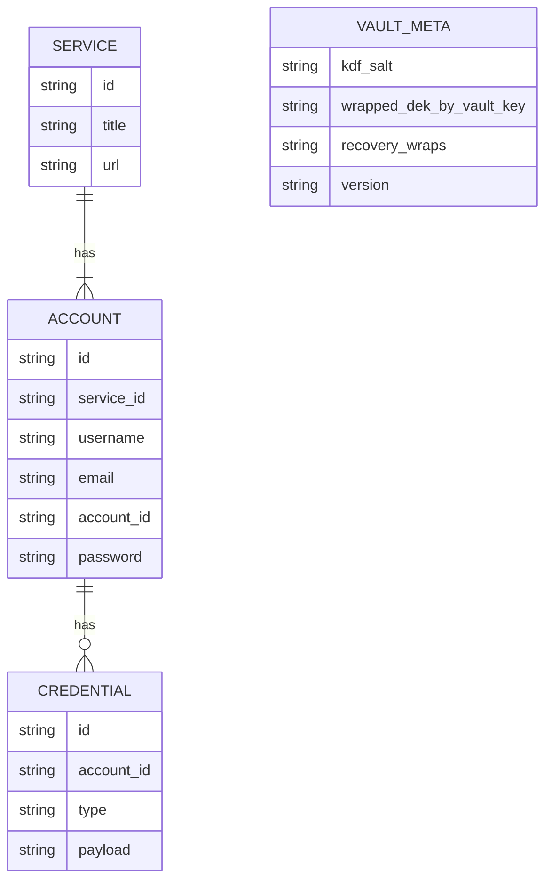
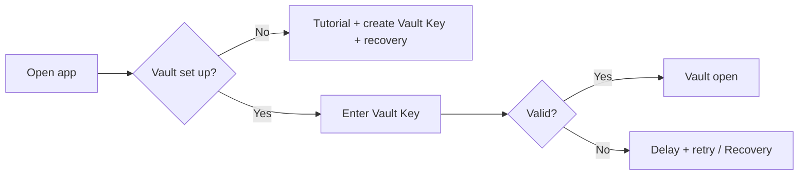

# Architecture

## Stack
| Layer | Choice |
|---|---|
| UI | Vite + React + TypeScript (from Figma Make) |
| Native shell | Capacitor (Android) |
| Storage | Encrypted local SQLite (ciphertext only) |
| Crypto | Web Crypto (AES-256-GCM) + Argon2id (WASM library) |
| Strength check | zxcvbn-ts |
| Generator | `crypto.getRandomValues` |

## Layers


## Data model

Every table also has `deleted_at` (null = active, set = in Recycle Bin). Rules: a service has 1+ accounts; an account has 0+ credentials. Sensitive fields are stored encrypted. `type` examples: `passkey`, `security_question`, `other`.

## Unlock flow


## Folder layout (code)
```
src/
  ui/          screens and components
  services/    vault, auth, recovery
  crypto/      kdf, encrypt, wrap
  data/        sqlite repository, schema
  theme/       tokens
```
